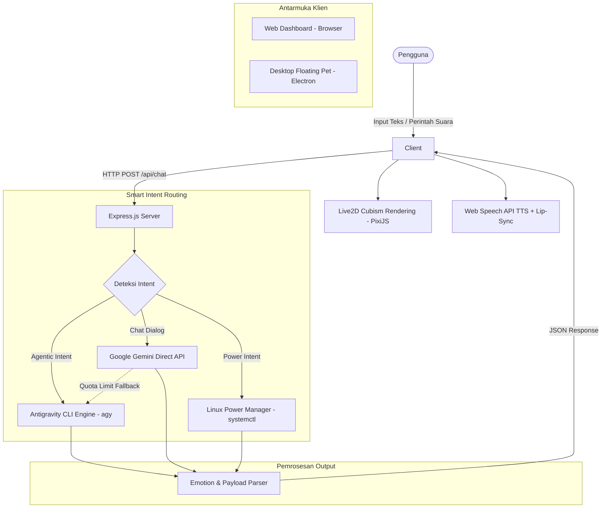

<div align="center">

# ⚡ Akeno — Live2D AI Assistant & Desktop Companion

**Next-Generation Interactive Live2D Desktop Companion & Web Assistant powered by Google Gemini and Antigravity Agentic Engine**

[](https://nodejs.org/)
[](https://expressjs.com/)
[](https://www.electronjs.org/)
[](https://ai.google.dev/)
[](https://www.live2d.com/)
[](https://ubuntu.com/)
[](LICENSE)

<br/>

[Fitur Unggulan](#-fitur-unggulan) •
[Arsitektur](#-arsitektur-sistem) •
[Prasyarat](#-prasyarat-sistem) •
[Instalasi](#-panduan-instalasi) •
[Konfigurasi](#-konfigurasi-env) •
[Cara Menjalankan](#-cara-menjalankan-aplikasi) •
[Model Live2D Kustom](#-menambahkan-model-live2d-kustom) •
[API Reference](#-api-endpoints)

</div>

---

## 📖 Ringkasan Proyek

**Akeno Live2D AI Assistant** adalah aplikasi pendamping berbasis kecerdasan buatan (*AI Companion*) yang menggabungkan ekspresi visual dinamis dari model **Live2D Cubism 4** dengan kecerdasan bahasa multimodal dari **Google Gemini** serta kemampuan automasi sistem dari **Antigravity Agentic Engine**.

Aplikasi ini dapat dioperasikan dalam dua mode fleksibel:
1. **Desktop Floating Pet (Electron)**: Avatar transparan tanpa batas (*borderless*), selalu berada di atas jendela lain (*always-on-top*), responsif terhadap kursor, dilengkapi fitur *Ghost Mode* (tembus klik), penghindar jendela (*dodge*), dan kontrol *System Tray*.
2. **Web Dashboard (Full App)**: Antarmuka berbasis browser responsif dengan panel obrolan modern (*glassmorphism*), kontrol emosi avatar real-time, bubble chat interaktif, dan panel pengaturan modal.

---

## ✨ Fitur Unggulan

- 🎭 **Live2D Cubism 4 Expression & Lip-Sync**: Animasi gerak mulut sinkron dengan ucapan (*Text-to-Speech*), ekspresi emosional otomatis (*senyum, goda, fokus, senang, khawatir, berpikir*), dan interaksi sentuhan (*touch/tap physics*).
- 🧠 **Dual-Engine Smart Routing**:
  - **Conversational Engine**: Dialog cepat, ramah, dan kontekstual menggunakan Google Gemini API (`@google/genai`).
  - **Agentic Engine**: Eksekusi perintah sistem Linux, manajemen file, git operations, dan debugging kode melalui Antigravity CLI (`agy`).
- ⚡ **Kontrol Daya Sistem (OS Power Management)**: Memahami perintah natural bahasa untuk menidurkan laptop (`suspend`/`sleep`), hibernasi (`hibernate`), memuat ulang sistem (`reboot`), atau mematikan sistem (`poweroff`).
- 👻 **Desktop Companion Mode (Electron)**:
  - Jendela transparan tanpa frame (*borderless transparent window*).
  - **Ghost Mode**: Mengabaikan klik mouse sehingga tidak menghalangi pekerjaan atau aplikasi di belakangnya.
  - **Smart Dodge**: Berpindah posisi antar sudut layar (kanan/kiri) secara instan saat menghalangi fokus pengguna.
  - **Tray Integration**: Manajemen status avatar langsung dari taskbar / panel sistem.
- 🎨 **Modular Model Support**: Mendukung penggantian model Live2D Cubism 3/4 kustom secara langsung melalui konfigurasi web atau berkas model.

---

## 🏛️ Arsitektur Sistem



---

## 📋 Prasyarat Sistem

Sebelum memulai instalasi, pastikan lingkungan pengembangan Anda telah memenuhi spesifikasi berikut:

- **Node.js**: Versi `18.x`, `20.x`, atau `24.x` (LTS direkomendasikan)
- **NPM**: Versi `9.x` atau lebih baru
- **Sistem Operasi**: Linux / Ubuntu (didukung penuh untuk window transparency via X11/Wayland dan system power commands)
- **Google Gemini API Key**: Dapatkan secara gratis melalui [Google AI Studio](https://aistudio.google.com/)
- *(Opsional)* **Antigravity CLI (`agy`)**: Untuk mengaktifkan kapabilitas agentic dan eksekusi perintah terminal otomatis

---

## 🚀 Panduan Instalasi

### 1. Kloning atau Buka Direktori Proyek

```bash
cd "Waifu Gemini Assistant"
```

### 2. Pasang Dependensi Node.js

```bash
npm install
```

### 3. Konfigurasi Environment Variables

Salin berkas template lingkungan `.env.example` menjadi `.env`:

```bash
cp .env.example .env
```

Buka dan sesuaikan berkas `.env` menggunakan teks editor pilihan Anda:

```bash
nano .env
```

---

## ⚙️ Konfigurasi `.env`

Konfigurasi aplikasi disimpan pada berkas `.env` di root direktori proyek:

```env
# Google Gemini API Key dari Google AI Studio
GEMINI_API_KEY="YOUR_GEMINI_API_KEY_HERE"

# Pilihan model: gemini-3.8-flash, gemini-3.5-flash, gemini-3.1-pro-preview
GEMINI_MODEL="gemini-3.8-flash"

# Port server Express lokal
PORT=3000
```

| Parameter | Tipe | Wajib | Keterangan |
|---|---|---|---|
| `GEMINI_API_KEY` | `string` | **Ya** | API key Google Gemini yang valid. |
| `GEMINI_MODEL` | `string` | Tidak | Model LLM yang digunakan (default: `gemini-3.8-flash`). |
| `PORT` | `number` | Tidak | Port HTTP lokal untuk server backend (default: `3000`). |

> [!TIP]
> Jika `GEMINI_API_KEY` tidak diatur atau kuota habis, backend secara otomatis melakukan *fallback* cerdas ke Antigravity CLI (`agy`) untuk memastikan layanan tetap berjalan tanpa henti.

---

## 🖥️ Cara Menjalankan Aplikasi

Aplikasi menyediakan dua cara eksekusi tergantung kebutuhan penggunaan Anda:

### Mode 1: Web Interface (Dashboard Browser)

Jalankan server backend Express:

```bash
npm start
```

Setelah server aktif, buka peramban web dan akses:
```
http://localhost:3000
```

### Mode 2: Desktop Floating Companion (Electron)

Untuk menampilkan avatar mengambang transparan di atas semua jendela desktop:

```bash
# Pastikan server telah berjalan (npm start), lalu jalankan:
npm run desktop
```

Atau gunakan launcher mandiri yang otomatis menyalakan server dan klien desktop:

```bash
./start-floating.sh
```

---

## 🎮 Kontrol & Interaksi Desktop Pet

Pada mode desktop floating pet, Anda dapat berinteraksi dengan avatar melalui kontrol berikut:

| Aksi | Cara Penggunaan | Fungsi |
|---|---|---|
| **Toggle Menu Chat** | Klik ikon pill chat di bawah avatar | Membuka kolom input cepat untuk mengirim pesan |
| **Dodge / Pindah Sisi** | Klik tombol panah ganda `⇄` | Memindahkan posisi avatar antara pojok kanan bawah dan kiri bawah |
| **System Tray Menu** | Klik kanan ikon tray di panel taskbar | Akses cepat: Sembunyikan, Ghost Mode, Ubah Sudut Layar, Buka Web |
| **Ghost Mode (Tembus Klik)** | Aktifkan via tray context menu | Membuat jendela tembus klik mouse sehingga tidak menghalangi aplikasi kerja |
| **Repositioning** | Pilihan menu *Posisi Layar* di Tray | Memilih posisi spesifik (Kanan Bawah, Kiri Bawah, Tepi Tengah) |

---

## 📁 Menambahkan Model Live2D Kustom

Aplikasi dirancang modular sehingga Anda dapat menggunakan model Live2D Cubism (`.moc3`) pilihan Anda sendiri.

### Langkah-langkah:

1. Buat folder baru di dalam direktori `public/models/`:
   ```bash
   mkdir -p public/models/nama_karakter
   ```

2. Letakkan seluruh aset model Live2D ke dalam folder tersebut:
   ```
   public/models/nama_karakter/
   ├── nama_karakter.moc3
   ├── nama_karakter.model3.json
   ├── nama_karakter.physics3.json
   ├── textures/
   │   └── texture_00.png
   └── motions/
       └── idle.motion3.json
   ```

3. Ganti path model pada menu **Pengaturan (Settings Modal)** di Web Dashboard, atau perbarui variabel `defaultModelPath` pada [public/app.js](file:///home/user/Waifu%20Gemini%20Assistant/public/app.js):
   ```javascript
   let defaultModelPath = 'models/nama_karakter/nama_karakter.model3.json';
   ```

---

## 📡 API Endpoints

Backend mengekspos endpoint REST API untuk integrasi komunikasi data:

### 1. `POST /api/chat`
Mengirim pesan dari pengguna ke asisten AI dan menerima respons emosional.

- **Request Body:**
  ```json
  {
    "message": "Halo, tolong cek status penggunaan memori laptop ini",
    "history": [
      { "role": "user", "text": "Halo" },
      { "role": "model", "text": "Halo! Ada yang bisa kubantu?" }
    ]
  }
  ```

- **Response Body:**
  ```json
  {
    "reply": "Ara ara... ini status penggunaan memori laptopmu saat ini: Total RAM 16GB, terpakai 4.2GB.",
    "fullText": "[senyum_lembut] Ara ara... ini status penggunaan memori laptopmu saat ini...",
    "emotion": "senyum_lembut",
    "isAgentic": true
  }
  ```

### 2. `GET /api/status`
Mendapatkan status konfigurasi dan engine AI yang aktif saat ini.

- **Response Body:**
  ```json
  {
    "configured": true,
    "engine": "Antigravity Agentic + Gemini 3.5 Flash",
    "isAgenticVessel": true
  }
  ```

---

## 📂 Struktur Direktori

```plaintext
Waifu Gemini Assistant/
├── .env.example             # Berkas template konfigurasi environment
├── .gitignore               # Daftar berkas/direktori yang diabaikan git
├── package.json             # Manifest dependensi & skrip Node.js
├── server.js                # Server backend Express & smart intent router
├── electron-main.js         # Entry point Electron desktop floating window
├── start-floating.sh        # Skrip otomatis untuk menjalankan floating pet
├── README.md                # Dokumentasi utama proyek
└── public/
    ├── index.html           # Halaman web dashboard utama
    ├── style.css            # Desain styling antarmuka web (Glassmorphism)
    ├── app.js               # Logika klien web, event handling & Live2D renderer
    ├── desktop.html         # Tampilan minimalis transparan untuk Electron pet
    ├── desktop.css          # Desain styling overlay floating companion
    ├── desktop.js           # Logika klien Electron & interaksi mini chat
    ├── tray.png             # Ikon sistem tray Electron
    └── models/
        └── haru/            # Aset model Live2D Cubism default
            ├── haru_greeter_t03.moc3
            ├── haru_greeter_t03.model3.json
            └── ...
```

---

## ❓ FAQ & Troubleshooting

<details>
<summary><b>1. Mengapa jendela desktop Electron tidak transparan di Linux?</b></summary>
<p>
Pastikan window compositor aktif pada sistem Linux Anda (misalnya Picom pada X11 atau compositor Wayland asli). Jalankan aplikasi dengan flag <code>--ozone-platform=x11</code> dan <code>--enable-transparent-visuals</code> (sudah terkonfigurasi secara otomatis pada <code>electron-main.js</code>).
</p>
</details>

<details>
<summary><b>2. Mengapa perintah daya sistem (misal: "matikan laptop") gagal dieksekusi?</b></summary>
<p>
Aplikasi memanfaatkan perintah standar <code>systemctl</code> tanpa sudo password (seperti <code>systemctl suspend -i</code> atau <code>systemctl poweroff -i</code>). Pastikan user Linux Anda memiliki hak akses polkit standar untuk power management pada sesi lokal.
</p>
</details>

<details>
<summary><b>3. Bagaimana jika kuota Gemini API saya habis?</b></summary>
<p>
Sistem telah dilengkapi mekanisme fail-safe otomatis. Apabila request ke Google Gemini API mengembalikan error quota limit, server akan mengalihkan pemrosesan secara transparan ke Antigravity Agentic CLI tanpa memutuskan alur obrolan.
</p>
</details>

---

## 📜 Lisensi & Atribusi

- Dilisensikan di bawah [ISC License](LICENSE).
- **Live2D Cubism SDK**: Hak cipta milik © Live2D Inc. Penggunaan model Live2D mematuhi syarat lisensi Live2D Cubism SDK.
- **PixiJS**: Dilisensikan di bawah lisensi MIT.
- **Google Gemini**: Disediakan oleh Google AI Platform.

### Mode 2: Desktop Floating Companion (Electron)

Untuk menampilkan avatar mengambang transparan di atas semua jendela desktop:

```bash
# Pastikan server telah berjalan (npm start), lalu jalankan:
npm run desktop
```

Atau gunakan launcher mandiri yang otomatis menyalakan server dan klien desktop:

```bash
./start-floating.sh
```

---

## 🎮 Kontrol & Interaksi Desktop Pet

Pada mode desktop floating pet, Anda dapat berinteraksi dengan avatar melalui kontrol berikut:

| Aksi | Cara Penggunaan | Fungsi |
|---|---|---|
| **Toggle Menu Chat** | Klik ikon pill chat di bawah avatar | Membuka kolom input cepat untuk mengirim pesan |
| **Dodge / Pindah Sisi** | Klik tombol panah ganda `⇄` | Memindahkan posisi avatar antara pojok kanan bawah dan kiri bawah |
| **System Tray Menu** | Klik kanan ikon tray di panel taskbar | Akses cepat: Sembunyikan, Ghost Mode, Ubah Sudut Layar, Buka Web |
| **Ghost Mode (Tembus Klik)** | Aktifkan via tray context menu | Membuat jendela tembus klik mouse sehingga tidak menghalangi aplikasi kerja |
| **Repositioning** | Pilihan menu *Posisi Layar* di Tray | Memilih posisi spesifik (Kanan Bawah, Kiri Bawah, Tepi Tengah) |

---

## 📁 Menambahkan Model Live2D Kustom

Aplikasi dirancang modular sehingga Anda dapat menggunakan model Live2D Cubism (`.moc3`) pilihan Anda sendiri.

### Langkah-langkah:

1. Buat folder baru di dalam direktori `public/models/`:
   ```bash
   mkdir -p public/models/nama_karakter
   ```

2. Letakkan seluruh aset model Live2D ke dalam folder tersebut:
   ```
   public/models/nama_karakter/
   ├── nama_karakter.moc3
   ├── nama_karakter.model3.json
   ├── nama_karakter.physics3.json
   ├── textures/
   │   └── texture_00.png
   └── motions/
       └── idle.motion3.json
   ```

3. Ganti path model pada menu **Pengaturan (Settings Modal)** di Web Dashboard, atau perbarui variabel `defaultModelPath` pada [public/app.js](file:///home/user/Waifu%20Gemini%20Assistant/public/app.js):
   ```javascript
   let defaultModelPath = 'models/nama_karakter/nama_karakter.model3.json';
   ```

---

## 📡 API Endpoints

Backend mengekspos endpoint REST API untuk integrasi komunikasi data:

### 1. `POST /api/chat`
Mengirim pesan dari pengguna ke asisten AI dan menerima respons emosional.

- **Request Body:**
  ```json
  {
    "message": "Halo, tolong cek status penggunaan memori laptop ini",
    "history": [
      { "role": "user", "text": "Halo" },
      { "role": "model", "text": "Halo! Ada yang bisa kubantu?" }
    ]
  }
  ```

- **Response Body:**
  ```json
  {
    "reply": "Ara ara... ini status penggunaan memori laptopmu saat ini: Total RAM 16GB, terpakai 4.2GB.",
    "fullText": "[senyum_lembut] Ara ara... ini status penggunaan memori laptopmu saat ini...",
    "emotion": "senyum_lembut",
    "isAgentic": true
  }
  ```

### 2. `GET /api/status`
Mendapatkan status konfigurasi dan engine AI yang aktif saat ini.

- **Response Body:**
  ```json
  {
    "configured": true,
    "engine": "Antigravity Agentic + Gemini 3.5 Flash",
    "isAgenticVessel": true
  }
  ```

---

## 📂 Struktur Direktori

```plaintext
Waifu Gemini Assistant/
├── .env.example             # Berkas template konfigurasi environment
├── .gitignore               # Daftar berkas/direktori yang diabaikan git
├── package.json             # Manifest dependensi & skrip Node.js
├── server.js                # Server backend Express & smart intent router
├── electron-main.js         # Entry point Electron desktop floating window
├── start-floating.sh        # Skrip otomatis untuk menjalankan floating pet
├── README.md                # Dokumentasi utama proyek
└── public/
    ├── index.html           # Halaman web dashboard utama
    ├── style.css            # Desain styling antarmuka web (Glassmorphism)
    ├── app.js               # Logika klien web, event handling & Live2D renderer
    ├── desktop.html         # Tampilan minimalis transparan untuk Electron pet
    ├── desktop.css          # Desain styling overlay floating companion
    ├── desktop.js           # Logika klien Electron & interaksi mini chat
    ├── tray.png             # Ikon sistem tray Electron
    └── models/
        └── haru/            # Aset model Live2D Cubism default
            ├── haru_greeter_t03.moc3
            ├── haru_greeter_t03.model3.json
            └── ...
```

---

## ❓ FAQ & Troubleshooting

<details>
<summary><b>1. Mengapa jendela desktop Electron tidak transparan di Linux?</b></summary>
<p>
Pastikan window compositor aktif pada sistem Linux Anda (misalnya Picom pada X11 atau compositor Wayland asli). Jalankan aplikasi dengan flag <code>--ozone-platform=x11</code> dan <code>--enable-transparent-visuals</code> (sudah terkonfigurasi secara otomatis pada <code>electron-main.js</code>).
</p>
</details>

<details>
<summary><b>2. Mengapa perintah daya sistem (misal: "matikan laptop") gagal dieksekusi?</b></summary>
<p>
Aplikasi memanfaatkan perintah standar <code>systemctl</code> tanpa sudo password (seperti <code>systemctl suspend -i</code> atau <code>systemctl poweroff -i</code>). Pastikan user Linux Anda memiliki hak akses polkit standar untuk power management pada sesi lokal.
</p>
</details>

<details>
<summary><b>3. Bagaimana jika kuota Gemini API saya habis?</b></summary>
<p>
Sistem telah dilengkapi mekanisme fail-safe otomatis. Apabila request ke Google Gemini API mengembalikan error quota limit, server akan mengalihkan pemrosesan secara transparan ke Antigravity Agentic CLI tanpa memutuskan alur obrolan.
</p>
</details>

---

## 📜 Lisensi & Atribusi

- Dilisensikan di bawah [ISC License](LICENSE).
- **Live2D Cubism SDK**: Hak cipta milik © Live2D Inc. Penggunaan model Live2D mematuhi syarat lisensi Live2D Cubism SDK.
- **PixiJS**: Dilisensikan di bawah lisensi MIT.
- **Google Gemini**: Disediakan oleh Google AI Platform.

